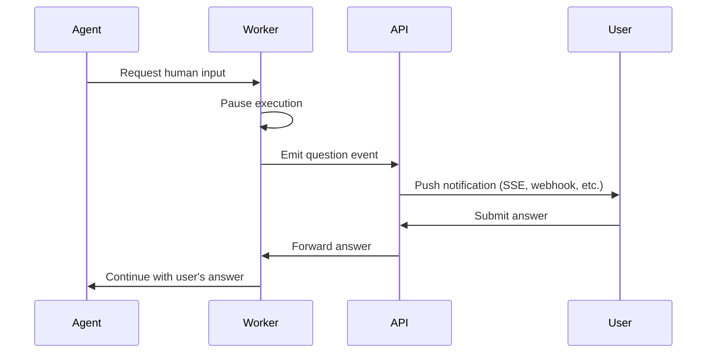

# Chapter 8: Policy & Guardrails

> Tool restrictions, autonomy ceilings, governed actions, approval gates, policy-as-code generation, and organizational policy enforcement.

---

## The Policy Plane

Policy determines what the agent is actually allowed to do. The LLM decides *what* to do; policy decides *whether it's allowed*.

This chapter covers the full policy stack: from structural constraints the agent can't bypass, through prompt-level rules that guide its behavior, to runtime enforcement that validates every action — and crucially, how agents can **generate enforceable policy** from soft rules, closing the loop between human intent and machine enforcement.

---

## Three Layers of Guardrails

```
┌────────────────────────────────────────────────────┐
│  Layer 1: STRUCTURAL GUARDRAILS                    │
│  Built into architecture. Cannot be bypassed.      │
│  • Workers can't access DB                         │
│  • Sandbox containers have network restrictions    │
│  • Credential broker validates every request       │
│  • Max iteration limits enforced in code           │
└───────────────────────┬────────────────────────────┘
                        │
┌───────────────────────▼────────────────────────────┐
│  Layer 2: PROMPT-LEVEL RULES                       │
│  Encoded in system prompts. Model-enforced.        │
│  • "Never push to main"                            │
│  • "Always validate before PR"                     │
│  • "Max 10 drift iterations"                       │
│  • Organization-specific policies                  │
└───────────────────────┬────────────────────────────┘
                        │
┌───────────────────────▼────────────────────────────┐
│  Layer 3: RUNTIME POLICY ENGINE                    │
│  Evaluated at dispatch and tool-call time.         │
│  • Tool allow/deny lists                           │
│  • Autonomy ceiling enforcement                    │
│  • Human approval requirements                     │
│  • Budget/rate limits                              │
│  • Server-owned gateways for governed actions      │
└────────────────────────────────────────────────────┘
```

Layer 2 (prompt rules) is the weakest — models can be manipulated. Layers 1 and 3 must catch what Layer 2 misses. But Layer 2 has a unique superpower: it's the only layer that understands *intent*. The model can read a policy like "all S3 buckets must use our KMS key" and generate the Terraform, the Azure Policy definition, or the OPA rule to enforce it structurally. This is how soft guardrails become hard guardrails — the agent itself closes the gap.

---

## Tool Allow/Deny Lists

Every agent type should have an explicit list of tools it can and cannot use. This is a structural guardrail — enforced at the runtime level, not the prompt level.

```yaml
# Example: tool permissions per agent type
agent_types:
  compliance-scanner:
    allowed_tools:
      - read-file
      - git-diff
      - git-log
      - describe-resource
      - list-resources
      - query-findings
    denied_tools:
      - write-file
      - git-push
      - git-commit
      - terraform-apply
      - kubectl-apply
      - cloud-credentials:write

  remediation-agent:
    allowed_tools:
      - read-file
      - write-file
      - git-checkout
      - git-commit
      - git-push
      - create-pr
      - describe-resource
      - list-resources
      - terraform-plan       # Can plan, not apply
    denied_tools:
      - terraform-apply
      - kubectl-apply
      - cloud-credentials:write

  drift-agent:
    allowed_tools:
      - read-file
      - write-file
      - git-checkout
      - git-commit
      - git-push
      - create-pr
      - terraform-plan
      - terraform-show
    denied_tools:
      - terraform-apply
      - terraform-destroy    # Explicit deny — never
```

Enforce tool lists at the runtime level, not the prompt level. When the agent calls a denied tool, the runtime rejects the call before it executes — no matter what the LLM was instructed to do.

```typescript
function executeToolCall(toolName: string, args: any, agentType: string): Result {
  const permissions = getToolPermissions(agentType);

  if (permissions.deniedTools.includes(toolName)) {
    return { error: `Tool '${toolName}' is denied for agent type '${agentType}'` };
  }

  if (!permissions.allowedTools.includes('*') &&
      !permissions.allowedTools.includes(toolName)) {
    return { error: `Tool '${toolName}' is not in the allow list` };
  }

  return tool.execute(args);
}
```

The deny list always wins. If a tool appears in both the allow and deny lists, it's denied. This prevents accidental permission grants when using wildcard allows.

Managed agent definitions can enforce part of this layer before a task starts. For example, an enterprise-managed `terraform-reviewer` subagent can define a read-only tool list, a specific model, a max-turn budget, and approved skills/MCP servers. That is useful because it keeps baseline roles consistent across repositories and prevents project-local configuration from silently expanding access.

Do not treat managed agent definitions as the only enforcement point. The runtime should still reject denied tools, the credential broker should still scope tokens, and change control should still require PRs or break-glass approvals.

---

## Autonomy Ceilings in Practice

[Chapter 10](./10-autonomy-notifications.md#autonomy-is-a-dial) describes autonomy as four levels, defined by what the human still decides. This section is the other side of the same dial: the **ceiling** the runtime enforces, whatever the agent was asked to do or decides to try. A ceiling is set per workspace (or per environment) by an admin, it starts at Off, and every change to it is an audit event.

| Ceiling | What the agent may do | What it may not do |
|---------|----------------------|--------------------|
| **Off** | Nothing on its own initiative | Start any unattended work |
| **Observe** | Read repositories, provider APIs and inventory; detect and report | Write anything, or hold raw cloud credentials |
| **Propose** | Everything in Observe, plus create branches and pull requests | Merge, apply, or mutate cloud resources directly |
| **Governed** | Everything in Propose, plus land eligible changes through server-side gateways (see [Governed Actions](#governed-actions)) | Merge or apply by itself, or touch paths the rules always send to a person |

Three controls sit beside the ceilings:

- **Production opt-in.** Production writes, and raw cloud credentials for production, need a separate opt-in that is only valid at Governed. Raw provider credentials cannot technically enforce read-only use, so they get their own switch. Lowering the ceiling below Governed clears the opt-in automatically.
- **Emergency stop.** One switch forces the effective ceiling to Off immediately but keeps the selected one, so releasing it restores the previous setting. Test it before you need it.
- **Break-glass execution** is not a ceiling. Direct changes outside the PR workflow belong in a separate system with separate credentials, a change ticket and a named approver on every action. Most teams never need it.

How the levels in Chapter 10 map onto ceilings: level 0 runs with the requesting person's own authority (still PR-only for writes); level 1 needs Observe or Propose; level 2 needs Governed; level 3 can run under any ceiling, because it is about initiative, not authority. A goal-driven agent under a Propose ceiling still waits for a person on every merge.

```typescript
// Example: ceiling-to-capability mapping
const ceilingCapabilities = {
  off: { capabilities: [] },
  observe: {
    capabilities: ['repo:read', 'provider-api:read', 'inventory:read', 'findings:read'],
  },
  propose: {
    capabilities: ['repo:read', 'repo:branch', 'pr:create', 'pr:update-own',
                   'provider-api:read', 'inventory:read', 'pipeline:plan'],
  },
  governed: {
    capabilities: ['repo:read', 'repo:branch', 'pr:create', 'pr:update-own',
                   'provider-api:read', 'inventory:read', 'pipeline:plan',
                   'gateway:governed-merge', 'gateway:governed-apply'],
    requiresProductionOptIn: ['provider-api:write:production', 'cloud-credentials:production'],
  },
};
```

### Freeze the Policy per Run

Evaluate the ceiling once when a run starts, freeze it into a policy snapshot with its provenance (which ceiling, which person or service, which revision), and re-check the live ceiling on every capability request and every credential mint. The live state may only **lower** a frozen policy, never widen it, so an emergency stop, a downgrade or a production opt-out takes effect on bearers that already exist. If authority needs to go up, start a new run with a newly frozen policy instead of widening the old one. Service-originated runs should never be able to present the full authority of a manual session.

### Token Scopes Rarely Match Your Intent

Be careful about what a ceiling actually prevents. On GitHub, the `contents:write` permission a Propose agent needs to push a branch also allows merging, and `pull_requests:write` lets it update or review pull requests it didn't create. "Never merge" therefore cannot rest on token scopes alone. It has to be enforced by the server (the agent has no merge tool, and the gateway is the only path that merges), by branch protection the agent cannot bypass, and only last by instructions. Prefer providers and token types that can be restricted to exactly the repositories a run selected; we only attach a repository to continuous work when its provider can mint such a token.

---

## Governed Actions

At the Governed ceiling, some changes land without a person clicking merge. The agent still never merges or applies anything itself. It opens a PR as usual, and a **server-owned gateway** decides whether that PR is eligible to land. The model proposes; the gates decide.

### The Merge Gateway

A governed merge should require all of these, and return "approval required" if any evidence is missing:

- The run is a continuous run at the Governed ceiling, and the PR was created by that same session.
- The PR head is the exact commit the agent validated, and the provider confirms branch protection is in force with no bypass.
- For IaC, a successful validation run (plan, policy checks) from the same agent run, whose source commit equals the PR head. Store the plan digest in the receipt.
- An explicit, versioned **environment autonomy policy** that only admins can write. The agent cannot author or weaken it. Combine it with organization policy by taking the most restrictive value of each rule: allowed regions are intersected, required tags are unioned, and the lowest cost ceiling wins.
- Blast-radius limits. Ours are at most 25 files and 2,000 changed lines per governed merge, and at most 5 governed merges an hour and 20 a day, so one confident mistake can't become fifty.
- A fail-closed distributed lock, so two replicas cannot land two changes at once.

Some paths always go to a person, whatever the ceiling: CI and workflow definitions, identity and access, policy, secrets, database migrations, backend and provider configuration, and state. So does anything the rules cannot verify. Unknown is not permission.

### The Apply Gateway

Merging is half of the job; the change still has to be applied and confirmed. A governed apply is a small state machine that runs the team's own pipeline:

```
DECIDED ──► APPLY_RUNNING ──► VERIFY_RUNNING ──► SUCCEEDED
                 │                   │
                 └──── failure ──────┴──► ROLLBACK (exact revert to the pre-merge commit)
```

- It consumes the merge receipt and re-checks that the branch head is still the merge commit.
- It triggers the normal deployment pipeline with the commit SHA and the action ID, and the pipeline publishes an attestation of which commit it actually applied.
- Verification is a fresh scan that must show zero remaining changes.
- Any failure triggers an exact rollback to the pre-merge commit. If the branch has moved on since the apply, the rollback halts and asks a person, because reverting someone else's later change is worse than stopping.
- A rollback may continue after an emergency stop, because it is a compensating action rather than new work.

### Risk Classes

Not every action can earn autonomy. Classify actions before you decide where the gates sit:

| Risk class | Examples | Can it be governed? |
|-----------|----------|---------------------|
| **Reversible and bounded** | Tags, encryption settings, diagnostic settings, closing public access, version bumps within a minor release | Yes, after a track record |
| **Sensitive** | Network rules, scaling, multi-resource drift fixes, cross-environment changes | Approval-gated; a gate can prepare everything except the final click |
| **Irreversible** | Deleting data stores, rotating root credentials, state surgery, anything that touches identity | A person, always |

A runbook or environment policy can raise an action's risk class, never lower it.

### Receipts

If it is not a receipt, it did not happen. Record every governed decision and every execution as an append-only receipt:

```typescript
interface AutonomyReceipt {
  kind: 'DECISION' | 'EXECUTION' | 'VERIFICATION' | 'ROLLBACK';
  risk: 'LOW' | 'MEDIUM' | 'HIGH' | 'CRITICAL';
  decision?: 'SHADOW_ALLOW' | 'ALLOW' | 'DENY' | 'REQUIRE_APPROVAL';
  result: 'NOT_ATTEMPTED' | 'SUCCEEDED' | 'FAILED' | 'VERIFIED' | 'ROLLED_BACK';
  idempotencyKey: string;
  organizationId: string;      // plain IDs, not foreign keys
  sessionId: string;
  policyRevision: string;
  evidence: { headSha?: string; planDigest?: string; pipelineRunId?: string };
  createdAt: string;
}
```

Make the database reject `UPDATE` and `DELETE` on the receipts table. Retrying with the same idempotency key returns the identical earlier receipt, and a retry with the same key but different content is rejected. Store tenant and session IDs as plain values rather than foreign keys, so a retention job that deletes old sessions cannot cascade-delete governance evidence. `SHADOW_ALLOW` is useful during rollout: the gateway records that it *would* have landed the change while a person still clicks merge, which gives you the track record needed for promotion.

A "change safety" verdict written by the agent itself (PASS, WARN or BLOCK across deletions, exposure, IAM, policy and cost) is a useful input for reviewers, but it is advisory. Only checks the server runs count as gates.

---

## Organization-Level Policies

Organizations define policies in plain language (typically markdown). These are stored with version history, toggled on/off, and injected into the agent context at dispatch time.

Example policies:

```markdown
## Policy: No Direct Production Changes
- All changes to production environments MUST go through a pull request
- The PR MUST pass all CI checks before merge
- Production PRs require approval from a senior engineer
- Emergency changes follow the break-glass procedure documented in the runbook
```

```markdown
## Policy: Encryption at Rest
- All S3 buckets MUST use SSE-KMS with the organization's key (the default SSE-S3 is not enough)
- All RDS instances MUST have storage encryption enabled
- All EBS volumes MUST be encrypted
- When fixing encryption findings, use the organization's KMS key: alias/infra-key
```

```markdown
## Policy: Resource Naming
- All resources follow the pattern: {env}-{service}-{resource_type}
- Examples: prod-api-rds, staging-web-s3, dev-auth-lambda
- Tags required: Environment, Service, Owner, CostCenter, ManagedBy=terraform
```

### Policy Digest Injection

Before dispatching an agent, compile all active policies into a single document and include it in the agent's system prompt or context. The agent reads these as hard constraints — not suggestions.

The key requirement: policies must be **versioned** (so you can diff what changed), **auditable** (who edited, when), and **plain language** (so the person debugging agent behavior can read them without learning Rego or Sentinel).

---

## From Prompt Rules to Enforceable Policies

Here's the insight most teams miss: prompt-level policies don't have to stay soft. An agent that understands a natural-language policy can *generate* the enforceable policy code to make it structural.

```
┌───────────────────────────────────────────────────────────────────┐
│  POLICY GENERATION PIPELINE                                       │
│                                                                   │
│  Admin writes:                                                    │
│  "All S3 buckets must have server-side encryption (SSE-KMS)"      │
│                                                                   │
│         │                                                         │
│         ▼                                                         │
│  ┌──────────────┐    Agent reads the policy, understands intent,  │
│  │  Agent (LLM) │    and generates enforceable policy code:       │
│  └──────┬───────┘                                                 │
│         │                                                         │
│    ┌────┴─────────────────────────────────────────┐               │
│    │              │               │               │               │
│    ▼              ▼               ▼               ▼               │
│  Terraform     Azure Policy   AWS SCP /       OPA Rego /          │
│  resource      definition     Config Rule     Sentinel            │
│  validation                                                       │
│    │              │               │               │               │
│    └────┬─────────┴───────────────┴───────┬───────┘               │
│         ▼                                 ▼                       │
│    Pull Request                    Cloud-native                   │
│    (IaC change)                    enforcement                    │
│                                    (blocks non-compliant          │
│                                     deploys at the API level)     │
└───────────────────────────────────────────────────────────────────┘
```

This closes the loop: a human writes policy in plain language → the agent understands it → the agent generates enforceable policy code → the code goes through a PR → once merged, it becomes a structural guardrail that applies to *everyone*, not just the agent.

### What the Agent Can Generate

**AWS Service Control Policies (SCPs)** — Organization-wide deny rules:

```json
{
  "Version": "2012-10-17",
  "Statement": [{
    "Sid": "DenyOutsideApprovedRegions",
    "Effect": "Deny",
    "NotAction": [
      "iam:*", "organizations:*", "sts:*", "support:*",
      "cloudfront:*", "route53:*", "budgets:*"
    ],
    "Resource": "*",
    "Condition": {
      "StringNotEquals": {
        "aws:RequestedRegion": ["eu-west-1", "eu-central-1"]
      }
    }
  }]
}
```

For encryption rules, prefer bucket-default encryption with the organization's KMS key plus a detective Config rule over an SCP that denies `s3:PutObject` without an encryption header. S3 has encrypted every new object by default since 2023, and a header-based deny breaks uploads that rely on the bucket default.

**AWS Config Rules** — Detect non-compliant resources:

```yaml
# Generated by agent from: "All RDS instances must have encryption enabled"
Resources:
  RdsEncryptionRule:
    Type: AWS::Config::ConfigRule
    Properties:
      ConfigRuleName: rds-storage-encrypted
      Source:
        Owner: AWS
        SourceIdentifier: RDS_STORAGE_ENCRYPTED
      Scope:
        ComplianceResourceTypes:
          - AWS::RDS::DBInstance
```

**Azure Policy definitions** — Enforce at the ARM layer:

```json
{
  "properties": {
    "displayName": "Storage accounts must not allow public blob access",
    "policyType": "Custom",
    "mode": "All",
    "policyRule": {
      "if": {
        "allOf": [
          {
            "field": "type",
            "equals": "Microsoft.Storage/storageAccounts"
          },
          {
            "field": "Microsoft.Storage/storageAccounts/allowBlobPublicAccess",
            "notEquals": false
          }
        ]
      },
      "then": {
        "effect": "deny"
      }
    }
  }
}
```

**GCP Organization Policies** — Constraints at the org/folder/project level:

```yaml
# Generated from: "All GCS buckets must be in US regions"
constraint: constraints/gcp.resourceLocations
listPolicy:
  allowedValues:
    - in:us-locations
```

**OPA / Rego** — General-purpose policy enforcement against a Terraform plan (Rego v1 syntax, which OPA 1.0 and current Conftest require):

```rego
# Generated from: "No public S3 buckets"
package terraform.s3

import rego.v1

deny contains msg if {
  resource := input.resource_changes[_]
  resource.type == "aws_s3_bucket_acl"
  resource.change.after.acl in {"public-read", "public-read-write"}
  msg := sprintf("S3 bucket ACL '%s' must not be public", [resource.address])
}

deny contains msg if {
  resource := input.resource_changes[_]
  resource.type == "aws_s3_bucket_public_access_block"
  some setting in ["block_public_acls", "block_public_policy",
                   "ignore_public_acls", "restrict_public_buckets"]
  resource.change.after[setting] != true
  msg := sprintf("'%s' must set %s = true", [resource.address, setting])
}
```

**HashiCorp Sentinel** — Policy-as-code for Terraform Cloud/Enterprise:

```python
# Generated from: "All resources must have required tags"
import "tfplan/v2" as tfplan

required_tags = ["Environment", "Service", "Owner", "CostCenter"]

main = rule {
  all tfplan.resource_changes as _, rc {
    all required_tags as tag {
      rc.change.after.tags contains tag
    }
  }
}
```

### The Feedback Loop

The real power is the feedback loop between soft and hard enforcement:

```
1. Admin writes policy         "All EBS volumes must be encrypted"
                                      │
2. Agent reads policy          Injected into system prompt
   and remediates              Agent finds unencrypted volumes, fixes Terraform
                                      │
3. Agent generates             Produces an AWS Config Rule or SCP
   enforceable policy          that prevents future violations
                                      │
4. Enforcement goes            Agent opens a PR with the policy-as-code
   through standard PR         Team reviews and merges
                                      │
5. Policy is now structural    Cloud provider blocks non-compliant resources
                               at the API level — no agent needed
                                      │
6. Future scans find           The class of violation is eliminated,
   zero violations             not just individual instances
```

This is how an organization matures: the agent starts by *following* policies and fixing violations one by one, and eventually *generates the enforcement* that prevents the class of violation from ever occurring again.

### When to Generate vs. When to Remediate

Not every prompt-level policy should become cloud-native enforcement. Use this decision guide:

| Policy Type | Remediate (fix resources) | Generate enforcement (prevent future) |
|-------------|:------------------------:|:------------------------------------:|
| Encryption requirements | Yes — fix existing | Yes — SCP/Azure Policy/Config Rule |
| Tagging standards | Yes — add missing tags | Yes — SCP or Azure Policy |
| Network exposure (public access) | Yes — close it | Yes — SCP or security group rules |
| Naming conventions | Yes — rename | Maybe — hard to enforce at API level |
| Architecture patterns | Yes — refactor IaC | No — too context-dependent |
| Cost optimization | Yes — resize/delete | No — requires judgment |
| Region restrictions | Yes — move resources | Yes — GCP Org Policy / SCP |

The rule of thumb: if the policy is **binary** (compliant or not, no judgment needed), generate enforcement. If it requires **context** (is this the right instance size? is this architecture correct?), keep it as a prompt-level rule.

---

## Pre-Execution Validation

Before the agent's changes land, validate them programmatically against policy. This is the last line of defense before a PR is created.

```
Agent generates changes
        │
        ▼
┌─────────────────────────┐
│  terraform plan         │──── Does the plan match expectations?
│  terraform validate     │     Any resource deletions?
└───────────┬─────────────┘     Any permission changes?
            │
            ▼
┌─────────────────────────┐
│  Policy-as-code check   │──── OPA/Rego, Sentinel, Checkov,
│  (against the plan)     │     Trivy, custom rules
└───────────┬─────────────┘
            │
            ▼
┌─────────────────────────┐
│  Diff review            │──── Does the diff contain secrets?
│  (against the code)     │     Does it modify files outside scope?
└───────────┬─────────────┘     Does it exceed max lines changed?
            │
        ┌───┴───┐
        │       │
     Pass     Fail
        │       │
        ▼       ▼
   Create PR   Stop and report
                (log violation,
                 notify admin)
```

Run these checks **inside the agent loop**, not just in CI. The agent should catch violations before creating a PR, not after. This gives the agent a chance to self-correct:

1. Agent generates a Terraform change
2. Validation runs `checkov` or OPA against the plan
3. Checkov reports a violation (e.g., missing encryption)
4. Agent reads the violation, fixes the Terraform, and re-validates
5. Second pass succeeds — agent creates the PR

This self-correction loop is one of the biggest advantages agents have over static automation. A shell script that fails a policy check just fails. An agent that fails a policy check can read the error, understand what went wrong, and fix it.

---

## Policy Violation Response

When a policy violation is detected, the system needs a clear escalation path — not just "deny and log."

| Severity | Example | Response |
|----------|---------|----------|
| **Block** | Agent tries to use `terraform-destroy` | Deny the tool call. Log. Alert admin immediately. |
| **Escalate** | Agent wants write credentials for production | Pause execution. Request human approval. Resume or abort based on response. |
| **Warn** | Agent PR exceeds 500 lines changed | Allow but flag. Add warning label to PR. Notify reviewer. |
| **Audit** | Agent uses a tool not in its typical pattern | Allow. Log with extra detail. Include in daily digest. |

The escalation path should be configurable per organization. Some teams want strict blocking on everything; others want a lighter touch with audit-only for most violations. The policy engine should support both.

---

## Human-in-the-Loop (HITL) Checkpoints

When the agent reaches a decision point that requires human input:



The implementation pattern:
1. Agent calls a "request input" tool with a question and optional choices
2. Worker pauses execution and emits a question event to the notification system
3. User receives the question (via web UI, Slack, email) and responds
4. Worker receives the answer on a control channel and resumes the agent
5. A timeout (e.g., 24 hours) auto-fails the request if no human responds

The key design decision: **how does the worker wait?** Options include blocking on a Redis pub/sub channel, polling a database, or using a workflow engine (Temporal, Inngest) that natively supports human-in-the-loop pauses.


### Only Humans Approve

An approval is only an approval if an authenticated person made it through your API, and the server recorded it. Text in the chat ("yes, go ahead"), a file the agent wrote, or a decision made by a child session on behalf of its parent are not approval records. We added this rule explicitly after a delegated sub-session effectively approved an action its parent was waiting on. Bind each approval to the exact thing approved (a goal revision, a plan digest, a commit SHA) so that any change after approval needs a new one.

### Keep Tool Approvals in the Runtime

Per-tool approval defaults (`allow` or `ask`) should live in the agent runtime's own policy and be read on every turn, not copied into each session when it starts. Long-lived and goal-driven sessions otherwise keep running with yesterday's approval list; when the defaults live in the runtime, a tool that is newly marked "ask" takes effect from the next turn of every session.

---

## Budget & Rate Limits

Prevent runaway loops and cost explosions:

```typescript
interface AgentBudget {
  maxTurns: number;          // LLM round-trips (e.g., 50)
  maxTokens: number;         // Total token budget (e.g., 500_000)
  maxToolCalls: number;      // Total tool invocations (e.g., 200)
  maxDurationMs: number;     // Wall clock limit (e.g., 30 min)
  maxPipelineRuns: number;   // CI/CD pipeline triggers (e.g., 15)
  maxCredentialRequests: number;  // Token minting (e.g., 10)
}

// Enforce during execution
class BudgetTracker {
  private turns = 0;
  private tokens = 0;
  private toolCalls = 0;
  private startTime = Date.now();

  check(budget: AgentBudget): void {
    if (this.turns >= budget.maxTurns)
      throw new BudgetExceededError('Max turns reached');
    if (this.tokens >= budget.maxTokens)
      throw new BudgetExceededError('Token budget exhausted');
    if (Date.now() - this.startTime >= budget.maxDurationMs)
      throw new BudgetExceededError('Time limit exceeded');
  }

  recordTurn(tokensUsed: number) { this.turns++; this.tokens += tokensUsed; }
  recordToolCall() { this.toolCalls++; }
}
```

When a budget is exceeded, the agent should **stop gracefully** — not crash. Save whatever work has been done (partial analysis, draft PR), emit a structured event explaining which limit was hit, and notify the team. The admin can then decide whether to increase the budget and retry, or accept the partial result.

Set budgets per agent type, not globally. A compliance scanner analyzing 500 resources needs more turns than a single-file remediation agent. Reasonable defaults:

| Agent Type | Max Turns | Max Tokens | Max Duration | Max Pipeline Runs |
|-----------|-----------|-----------|-------------|------------------|
| Compliance scan | 100 | 1M | 60 min | 0 |
| Single-finding remediation | 30 | 200K | 15 min | 5 |
| Drift detection + fix | 50 | 500K | 30 min | 10 |
| PR review | 20 | 200K | 10 min | 0 |
| Cost analysis | 40 | 300K | 20 min | 0 |

---

## Guardrails Checklist

```
STRUCTURAL (Layer 1)
[ ] Tool allow/deny lists enforced at runtime, not prompt level
[ ] Deny list always wins over allow list
[ ] Sandbox network restrictions block metadata endpoints
[ ] Credential broker validates every request against policy
[ ] Max iteration limits enforced in code, not just prompt

PROMPT-LEVEL (Layer 2)
[ ] Organization policies injected into system prompt at dispatch
[ ] Policies are versioned with edit history
[ ] Agent generates enforceable policy code for binary rules (encryption, tagging, exposure)
[ ] Generated policies go through standard PR review

RUNTIME (Layer 3)
[ ] Autonomy ceilings defined per workspace/environment, starting at Off
[ ] Ceiling frozen per run; live state can only lower it; upgrades start a new run
[ ] "No merge" enforced by the server and branch protection, not token scopes
[ ] Governed merges and applies go through a server-owned gateway with blast-radius limits
[ ] Identity, secrets, CI, policy, migrations and state always go to a person
[ ] Append-only receipts for every governed decision, execution and rollback
[ ] Emergency stop tested end to end
[ ] Pre-execution validation runs inside the agent loop (not just CI)
[ ] Policy violations have clear escalation paths (block / escalate / warn / audit)
[ ] Budget limits set per agent type with graceful stop on exceed
[ ] HITL checkpoints implemented with timeout and fallback; only authenticated humans approve
[ ] If break-glass execution exists, it uses separate credentials, workflow, and audit paths
```

---

## Next Chapter

[Chapter 9: Observability & Audit →](./09-observability.md)

---

*Built by the team at [Cloudgeni](https://cloudgeni.ai) — Scale your infrastructure team. With Agents. Safely.*
