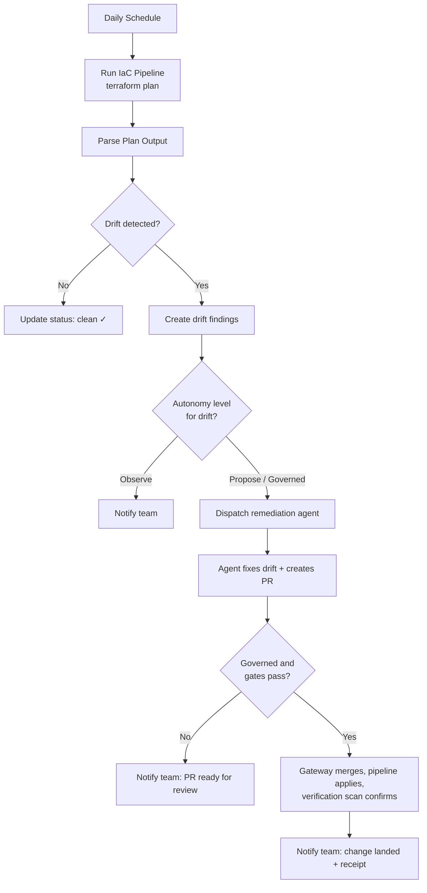
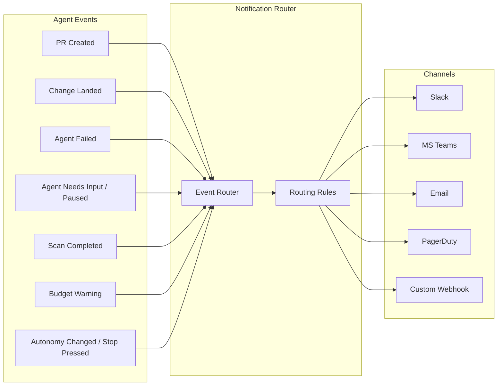

# Chapter 10: Autonomous Operations & Notifications

> The autonomy dial, signals and goals, scheduling, running unattended agents safely, notification routing, and escalation chains.

---

## Beyond Chat: Agents That Run on Their Own

Interactive chat gets the demos, but the most consistent value comes from agents that run on their own: they notice a problem, work out the fix, test it, and report back without anyone starting the conversation.

When we say an agent is **autonomous**, we mean it is capable of doing the whole job by itself, and the team decides how much of that job it is allowed to do. It does not mean handing over the keys. One team lets the agent observe and report, another lets it open pull requests, and a third lets it merge and apply small, reversible changes through deterministic gates. Whatever the setting, what reaches a person should not be a list of forty findings to triage but one decision: accept this change or not.

```
Signal (scan, drift, incident, goal) --> Agent works the problem --> Evidence + one decision
        ^                                        |                          |
        |                                        v                          v
   Next check                       Gates decide what it may do      Notify the owner
```

This chapter covers how to set that dial, how work reaches an unattended agent, how goals keep it going until the job is done, and what broke when we ran this in production.

---

## Autonomy Is a Dial

Think of autonomy as four levels, each defined by what the human still decides. The level is chosen **per use case**, not per company. It is normal to have an agent at level 3 tagging resources while another stays at level 0 for anything touching identity.

| Level | The agent... | You decide... | What must be in place first | Promote when |
|-------|--------------|---------------|-----------------------------|--------------|
| **0 · Reactive** | Does what you ask: an analysis, a fix, a PR. Nothing happens unless someone asks. | Every request and every result | A data boundary (what leaves your estate, which provider and region, retention terms), broker-issued short-lived credentials, PR-only writes | Results are accepted without rework most of the time |
| **1 · Propose** | Finds the work itself from scans, drift and new PRs, and opens the fix | Every merge | PR-first change control, validation before a PR may exist, git write access but no cloud write access, written-down standards ([Chapter 7](./07-change-control.md)) | Its PRs merge unmodified most of the time |
| **2 · Governed** | Lands low-risk changes itself through server-side gates | Risky changes and everything the rules can't verify | Rules in code rather than the prompt, change limits, a frozen per-run policy, human-only paths for identity, secrets, network and pipelines, receipts for every action ([Chapter 8](./08-policy-guardrails.md)) | Gates rarely escalate and verification rarely fails |
| **3 · Goal-driven** | Pursues goals continuously and stops only with evidence or a stated reason | Goals and exceptions | A runtime that survives restarts, durable goals with success criteria, escalation instead of guessing, a named owner per goal, and a tested stop button | — |

Two settings sit outside the levels. An **emergency stop** forces everything to off immediately while remembering the previous setting, so switching it back restores what was there. **Break-glass execution** (direct changes outside the PR workflow) is not a level at all; if you need it, build it as a separate system with its own credentials and approvals ([Chapter 8](./08-policy-guardrails.md#autonomy-ceilings-in-practice)).

Levels are earned on evidence, one use case and one action class at a time, never granted because a demo went well. [Chapter 13](./13-risk-framework.md#autonomy-decision-matrix) has the promotion thresholds. Cost changes shape as you climb, too: at level 0 you pay per request, at level 1 per PR, at level 2 per landed fix and at level 3 per goal, so measure cost per completed outcome rather than per token.

### Initiative and Authority Are Different Settings

There are two questions hiding inside "how autonomous is it": **who starts the work** (a person, a schedule, a signal or a goal) and **what the work may do** (read, propose, or land changes). Keep them as separate settings.

We learned this the hard way. Our first workspace autonomy switch also governed schedules that customers had created themselves, so turning autonomy down to Propose quietly downgraded the token of a customer's nightly "open a PR" schedule, and turning it Off skipped the schedule entirely. We split them: the autonomy setting now governs only work the agent starts on its own (its controller, its specialists and its self-scheduled wake-ups), while schedules, Git automations and incident triggers that a person configured run with that person's normal authority. If a team wants a schedule to run under the autonomy ceiling, it should say so explicitly on that schedule.

---

## Scheduling

### Example: Kubernetes CronJob

The simplest and most reliable approach is a cron trigger that calls your API:

```yaml
# Kubernetes CronJob — daily drift scan
apiVersion: batch/v1
kind: CronJob
metadata:
  name: daily-drift-scan
  namespace: agent-scheduler
spec:
  schedule: "0 6 * * *"  # Every day at 6:00 UTC
  concurrencyPolicy: Forbid  # Don't overlap
  jobTemplate:
    spec:
      template:
        spec:
          containers:
            - name: trigger
              image: curlimages/curl:latest
              env:
                - name: SCHEDULER_TOKEN
                  valueFrom:
                    secretKeyRef: { name: scheduler-token, key: token }
              command: ["/bin/sh", "-c"]
              args:
                - >
                  curl -fsS -X POST
                  -H "Content-Type: application/json"
                  -H "Authorization: Bearer ${SCHEDULER_TOKEN}"
                  -d '{"scope": "all-monitored-repos"}'
                  http://api-server/api/v1/internal/scheduled-tasks/drift-scan
          restartPolicy: OnFailure
```

The pattern is the same regardless of scheduler: an external trigger hits an authenticated API endpoint, which queries what needs scanning (based on configured frequency and last scan time) and dispatches tasks to the agent queue.

### Scheduling Comparison

| Approach | Reliability | Complexity | Catch-Up | Cost | Best For |
|----------|------------|-----------|----------|------|----------|
| **Kubernetes CronJob** | High | Low | Manual | Cluster | K8s-native |
| **AWS EventBridge Scheduler** | Very High | Low | Built-in | Per-invocation | AWS-native |
| **Azure Timer Functions** | Very High | Low | Built-in | Per-invocation | Azure-native |
| **Temporal Schedules** | Very High | Medium | Built-in | Server cost | Complex workflows |
| **In-process (croner/cron)** | Medium | Lowest | Manual | Free | Simple setups |
| **pg_cron (PostgreSQL)** | High | Low | Manual | Free | DB-centric |

If you run the scheduler in-process on a service with several replicas, every replica will fire every job unless one of them holds a lease. We ran a five-minute health canary that way and it started 357 to 630 sandbox-booting sessions a day, one per replica per run, and counted every failure once per replica. Give every periodic job a leader lease and fence its writes so a replica that lost the lease cannot save results.

### Scan Frequency Options

| Frequency | Use Case |
|-----------|----------|
| **Hourly** | High-value environments, incident response readiness |
| **Daily** | Default for most compliance and drift scanning |
| **Weekly** | Cost optimization, architecture reviews |
| **Monthly** | Low-change environments, audit reports |
| **Unmonitored** | Opt-out — no automatic scanning |

Track each configuration's last scan time and next scheduled scan to prevent duplicate dispatches and enable catch-up after outages. Offer a fixed set of cadence classes rather than free-form cron expressions for anything an agent is allowed to schedule for itself; it keeps the cost of a self-scheduled agent predictable.

### Preventing Schedule Overload

When scanning hundreds of repositories, stagger dispatches to avoid queue flooding:

```typescript
async function staggeredDispatch(
  tasks: AgentTask[],
  intervalMs: number = 5000
): Promise<void> {
  for (let i = 0; i < tasks.length; i++) {
    await dispatchTask(tasks[i]);

    if (i < tasks.length - 1) {
      await new Promise(resolve => setTimeout(resolve, intervalMs));
    }
  }
}
```

---

## Autonomous Use Cases

### 1. Continuous Drift Detection



The drift scan handler follows a simple decision tree:

1. **No drift**: mark the scan as clean and update the last scan timestamp.
2. **Drift detected**: create drift findings (resource address, change type, status).
3. **Check the autonomy level for this repository and signal**: at Observe, report only; at Propose or above, dispatch a remediation agent that opens a PR.
4. **Always notify**: send a notification to the configured channel, whatever the agent did.

```typescript
// Pseudocode: drift scan result handling
async function handleDriftScanResult(result: DriftScanResult) {
  if (result.driftResources.length === 0) {
    await markScanClean(result.scanId);
    return;
  }

  // Store drift findings for tracking
  const findings = await createDriftFindings(result.driftResources);

  // The autonomy ceiling, not a boolean flag, decides what happens next
  const ceiling = await getAutonomyCeiling(result.config.workspaceId, 'CONFIG_DRIFT');
  if (ceiling === 'propose' || ceiling === 'governed') {
    await upsertGoalForObservation({
      signal: 'CONFIG_DRIFT',
      sourceScanId: result.scanId,     // retry budget belongs to this observation
      repository: result.config.repository,
      findings,
    });
  }

  // Always notify
  await sendNotification(result.config.notificationChannel, {
    message: formatDriftNotification(result),
  });
}
```

### 2. Scheduled Compliance Scanning

Nightly: scan all connected cloud accounts for compliance findings. For each account with compliance scanning enabled, dispatch a task with the configured frameworks (CIS, SOC 2, ISO 27001). Results feed into the data plane, and qualifying findings become goals (see below) according to the autonomy level for that workspace.

### 3. Recurring Cost Optimization

Weekly: analyze cloud spending across accounts. A cost analysis agent identifies unused resources, rightsizing candidates and commitment coverage gaps. Keep cost work at Propose: whether an instance is the right size is a judgment call, and cost data is easy to misread (see [Trust the Signal First](#trust-the-signal-first)).

### 4. Automated PR Review

Event-driven rather than scheduled, but fully autonomous: when a PR is opened or updated, check whether the repository has automated review enabled and the PR contains IaC changes. If so, dispatch a review agent that analyzes the changes, runs validation tools, and posts review comments.

```typescript
// Example: webhook handler for automated PR review
async function handlePRWebhook(event: PREvent) {
  if (event.action === 'closed') {
    await cancelReviewsForPullRequest(event.repositoryId, event.number);
    return;
  }
  if (event.action !== 'opened' && event.action !== 'synchronize') return;
  if (!isReviewEnabled(event.repositoryId)) return;
  if (!hasIaCChanges(event.changedFiles)) return;

  // At most one running plus one queued review per PR; rapid pushes collapse
  await enqueueCollapsedReview({
    type: 'pr-review',
    payload: {
      pullRequestNumber: event.number,
      repositoryId: event.repositoryId,
      baseBranch: event.baseBranch,
      headSha: event.headSha,   // pin the commit, not the branch name
    },
  });
}
```

Pin the review to the head commit SHA. If you pin the branch name, PRs that are merged seconds after the trigger delete the branch before the agent clones it; we saw 45 such failures in 30 days before switching.

---

## From Signals to Goals

At level 1 and above the agent finds its own work. Each source of work (drift, static IaC findings, cloud security findings, compliance controls, observability incidents, cost anomalies, and desired-state goals for greenfield work) needs an adapter that decides whether a signal is good enough to act on. Most of the safety at these levels comes from what you refuse to turn into a goal.

| Signal | Eligibility rules that worked for us |
|--------|---------------------------------------|
| **Static IaC findings** | Only open, failed, high or critical findings. More than 200 eligible findings escalates to a person instead of fanning out. At most 25 findings go into one prompt. |
| **Compliance controls** | An exact control-to-resource mapping and exactly one IaC repository. Anything ambiguous escalates. |
| **Observability incidents** | A stable high or critical incident, a resource that maps to IaC in a known repository, and a fresh re-check at dispatch. Evidence older than 6 hours is stale. Never auto-merge from this source. |
| **Cost** | Proposal-only. Usage data must be less than 48 hours old, with no billing or currency ambiguity. |
| **Desired state (greenfield)** | A scheduled goal with written success criteria, one owner per scope, and quiescing the old owner when the goal is edited, paused or deleted. |

Three rules applied to every adapter. Scanner output, finding text and anything else from the outside world goes into the prompt fenced as untrusted data. Each new adapter shipped behind its own default-off flag and then a separate canary flag for governed actions. Each goal froze its source evidence, the scope it may touch, its policy, and measurable success criteria at creation, so later edits to the source could not widen it.

### Trust the Signal First

An agent that fixes findings is only as good as the findings. In the same quarter that we turned on autonomous remediation, we found scanner checks that failed healthy resources (23 false high-severity failures on one set of new key vaults), an outdated API version that hid diagnostic settings, 331 scans in 60 days where every chunk failed and the empty result auto-resolved all of the previous scan's findings, and user triage that the next scan overwrote. A cost API returned HTTP 200 with zero rows, which we read as zero spend. Fix these before you let an agent act on the signal:

- Treat "success with empty data" as unknown, not as zero or clean.
- A failed or partial scan must never auto-resolve findings.
- Separate scanner resolution from user resolution, and carry user decisions forward across scans.
- Give the agent lifecycle verbs as well as create verbs. Stale pipeline registrations from a decommissioned environment broke every drift scan in one workspace until the agent could deactivate them.

---

## Goal-Driven Continuation

Long-running autonomous work should stop because the objective is complete or safely paused, not merely because one model turn ended. Represent the goal as durable state with explicit success criteria:

```typescript
interface AgentGoal {
  objective: string;
  successCriteria: string[];
  status: 'active' | 'complete' | 'paused' | 'blocked' | 'cancelled';
  revision: number;
  tokenBudget: number;
  timeBudgetMs: number;
  noProgressCount: number;
  completionEvidence?: ArtifactRef[];
  pauseReason?: string;
}
```

When a turn ends while the goal is still active, schedule a durable continuation only after checking:

- no human approval or answer is pending
- the previous attempt committed observable progress
- token, time, tool-call, and spend budgets remain
- no newer user instruction, interrupt, or goal revision superseded the wake
- the continuation has one idempotent wake obligation, not multiple competing timers

Require `complete` to include evidence such as a PR, a passing plan, a test report, a finding resolution, or a verified artifact. Auto-pause after repeated no-progress continuations, and make budget exhaustion a visible paused state rather than a silent failure or an unbounded loop. Stopping early is a model's default; the goal is what keeps it working, and the longest goal-driven session we have run lasted 18 days.

This pattern comes from [Opengeni's durable goals](https://github.com/Cloudgeni-ai/opengeni/blob/main/docs/goals.md): completion, pause, interrupt, approval, and autonomous wake-up are explicit state transitions that survive worker restarts. It works especially well for infrastructure tasks that wait on CI, external scans, or human review.

### Two Kinds of Goal

In practice we ended up with two layers, and it helps to keep them apart.

**Remediation goals** are created by signals, one per observation. Each one moves through a small state machine and has a fixed retry budget:

```
OBSERVED ──► DISPATCH_PENDING ──► ACTIVE ──► AWAITING_VERIFICATION ──► RESOLVED
    │                                │                 │
    └──► SUPPRESSED                  └────► ESCALATED ◄┘
         (level is Off, stop pressed,       (attempts exhausted, policy denial,
          or out of scope)                   ambiguity, or the agent paused itself)
```

**Workspace goals** are the backlog of standing objectives ("keep every storage account private", "migrate these pipelines"). They move through `proposed → approved → active → paused | completed | rejected`. The agent may propose a goal and may activate a goal a human approved, but it may never approve one, edit its policy, or touch its credentials. Free-form conversation cannot create, approve or schedule a goal on its own. Approval binds the exact revision (we store a content hash), so any edit after approval needs a fresh approval. Approving from inside a conversation is fine as long as the approval is an authenticated action recorded by the server, written in the same transaction as the wake-up that resumes the agent.

### Recurring Goals and Cadence

A completed goal is terminal. When we tried to re-activate completed goals for recurring work, the runtime rejected it, and it was right to: each cycle should set a new goal with its own evidence trail.

Continuous does not mean always running. An agent that never stops is a bill. Our workspace agent sleeps between assessments, and these defaults have held up:

| Setting | Default |
|---------|---------|
| Base cadence | 6 hours, jittered |
| Quiet backoff | Doubles when nothing changes, capped at 24 hours |
| Minimum interval | 15 minutes, even when the agent schedules itself |
| Daily budget | 4 wakes and 2M tokens per workspace per UTC day; when exhausted, the next check moves to just after midnight UTC |
| Attempts per signal | 3, then a person is asked |

### One Owner per Goal

Unattended agents run on services with several replicas, and every one of those replicas runs the reconciler that turns goals into sessions. That is where our worst incident came from: one night the agent started 146 sessions for 5 goals in 15 minutes, and over the previous week one goal had reached 9 sessions while its counter said 3 of 3. There were two races. A replica re-armed a goal that another replica was still dispatching, because the session row existed before the runtime goal did. And re-processing the same scan (triggered by a stale snapshot, a settings change, or a triage action) reopened exhausted goals with a fresh attempt count, so two settings changes in one morning re-funded every escalated goal.

The rules we now follow:

- **Never re-arm while a dispatch lease is live.** Dispatch with compare-and-set on a lease column, and serialize per repository with an advisory lock.
- **Wait for the old owner to stop.** Do not start a replacement until the runtime confirms the previous session has paused and its last run has finished.
- **The retry budget belongs to the source observation.** Only a newer scan may reopen an exhausted goal. Settings changes, re-projection and triage never reset attempts.
- **Verify with a query, not a dashboard.** "Sessions per goal per scan ≤ max attempts" is a good alert.

### When the Agent Stops Itself

A good autonomous agent pauses when it is blocked, and tells you why. Our first version recorded the controller's status ("goal_inactive") instead of the agent's own rationale, and treated the escalation as a reason to cancel in-flight work, so three of six wrap-up runs were killed about 20 seconds after the agent paused, before it could write its report. Show the human the agent's own words ("needs a role assignment on subscription X"), tell agent-initiated pauses apart from controller-initiated ones, and let the agent finish its wrap-up turn.

---

## Who the Agent Acts As

A person starts an interactive session, so the session naturally runs as that person. Unattended work has no such person, and every place in your platform that silently assumes one will break.

- **Service-owned work needs an explicit identity and visibility.** When our runtime started rejecting private sessions owned by a service, every automated PR review failed within a second of starting. Service sessions should be shared with the organization by design.
- **Audit every capability for a "human started this turn" assumption.** Ours included publishing artifacts (which required human authority, so every autonomous migration plan failed to publish) and skills that were exposed only as a tool, so a script the agent needed was not on disk. Route an unattended agent's deliverable to the PR or the final report if a capability cannot be made service-safe.
- **Plan for owners leaving.** A goal owned by someone who had left the organization months earlier blocked goal control for seven hours, and an integration created by a departed member caused weeks of silently failed reviews in one organization. Use a deterministic, audited fallback (the initiator if they are still an active admin, otherwise the longest-standing active admin), apply it only to explicitly shared resources, fail closed if there is no admin, and re-home owned integrations when a member is removed. Never rewrite historical attribution.
- **Credentials follow the goal.** An autonomous run should receive credentials only while its goal still owns the session and the organization, workspace, signal, source, repository and scope fingerprint all match what was frozen at creation ([Chapter 5](./05-credential-management.md)).

---

## Notifications

Autonomous agents run in the background. Without notifications, you get two failure modes:

1. **Agent succeeds silently**: nobody reviews the PR, and the value is lost.
2. **Agent fails silently**: problems compound until a human notices.

The second one is more common than it sounds. Three of our worst autonomy failures (remediation runs failing at turn start for three weeks, automated reviews broken by a runtime change, and weeks of reviews lost to a departed owner) were each found by someone running SQL by hand. Alert on failure patterns, not just volume ([Chapter 9](./09-observability.md)).

### Notification Architecture



### Event Types and Severity

Categorize notification events by urgency so routing rules can direct them appropriately:

| Severity | Meaning | Examples |
|----------|---------|---------|
| **Info** | Agent completed work, scan finished clean | Drift remediated, scan clean, governed change verified |
| **Warning** | Budget threshold, partial failure, findings detected | Drift detected, budget exceeded |
| **Action** | Human action needed: PR review, approval, a paused goal | PR created, agent needs input, goal escalated |
| **Urgent** | Critical failure, critical security finding, rollback | Agent failed, critical finding, governed change rolled back |

Map each event type to a default severity:

| Event | Default Severity |
|-------|-----------------|
| `pr.created` | Action |
| `scan.completed.clean` | Info |
| `scan.completed.findings` | Warning |
| `drift.detected` | Warning |
| `drift.auto_remediated` | Info |
| `change.landed.verified` | Info |
| `change.rolled_back` | Urgent |
| `goal.escalated` | Action |
| `goal.paused_by_agent` | Action |
| `agent.failed` | Urgent |
| `agent.needs_input` | Action |
| `agent.budget_exceeded` | Warning |
| `autonomy.level_changed` | Info |
| `autonomy.emergency_stop` | Urgent |
| `finding.critical` | Urgent |

Each notification event should carry: type, severity, title, body, metadata (organization, agent, goal, repository, PR URL if applicable), and a deduplication key to prevent duplicate notifications for the same event.

### Deduplicate Before You Post

With several replicas watching the same work, "post then record" produces duplicates: our watchdog posted two identical "this is taking longer than usual" notices 0.7 seconds apart. Claim the notification first with a compare-and-set on the deduplication key, then post. If the process crashes between claim and post you lose one notice, which is better than spamming the channel. Also check that the work actually started before saying it is slow; we once sent delay notices for reviews that had already failed to start.

### Channel Implementations

Each channel follows the same pattern: receive a notification event, format it for the platform, and send it. Key considerations per channel:

| Channel | API / Protocol | Key Detail |
|---------|---------------|------------|
| **Slack** | Bot token + `chat.postMessage`, or incoming webhooks | Use Block Kit with buttons that deep-link to the PR or goal; thread follow-ups under the original message |
| **Microsoft Teams** | Workflows (Power Automate) webhook or a bot | Office 365 Connector incoming webhooks were retired in 2026. Send an Adaptive Card with a `FactSet` for metadata and `Action.OpenUrl` for PR links |
| **Email** (SendGrid/SES) | SMTP or REST API | Subject line: `[SEVERITY] title`. Use an HTML template with a plain-text fallback |
| **PagerDuty** | Events API v2 (`/v2/enqueue`) | Only trigger for `urgent` events. Set `routing_key`, `severity: 'critical'`, and the agent slug as source |
| **Generic Webhook** | HTTP POST | Pass `X-Event-Type` and `X-Severity` headers. Body is the full `NotificationEvent` JSON. Sign the body |

---

## Notification Routing Rules

Routing rules determine which events go to which channels. Each rule specifies:

- **Filter**: which event types, severities, agents, goals or repositories to match
- **Channel**: where to send (Slack, Teams, email, PagerDuty, webhook)
- **Deduplication window**: prevents duplicate notifications for the same event within a time window

The routing logic: for each notification event, evaluate all active rules for the organization. If the event matches a rule's filter and isn't deduplicated, send it to the configured channel.

This gives teams fine-grained control: "send all `urgent` events to PagerDuty, all `pr.created` events to #infra-prs in Slack, goal escalations to the goal owner directly, and daily digests to email."

---

## Daily Digests

Instead of individual notifications for every event, send periodic summaries. A daily digest should include:

- **Agent sessions**: total, completed, failed, and sessions per goal
- **PRs created**: count, with links to the most important ones
- **Changes landed by gates**: count, with their receipts, and any rollbacks
- **Goals**: completed, escalated (with the agent's stated reason), and waiting on a person
- **Spend**: cost per completed outcome, not just total tokens
- **Open findings**: new findings detected, findings auto-remediated
- **Failures**: any agent failures with brief context

Set the digest severity based on content: `warning` if there are failures, `info` if everything is clean. Route digests through the same notification system so teams can choose their preferred channel.

---

## Escalation Chains

For critical failures, escalate through channels with increasing urgency:

```
Minute 0:  Slack notification to #infra-agents channel
Minute 5:  Slack DM to on-call engineer
Minute 15: PagerDuty incident (if unacknowledged)
Minute 30: PagerDuty escalation to team lead
```

Run the chain from a durable scheduler (a delayed job, a workflow engine timer, or a database row a sweeper picks up), not from an in-memory timer that dies with the process:

```typescript
const chain = [
  { channel: 'slack', config: { channel: '#infra-agents' }, delayMs: 0 },
  { channel: 'slack', config: { mentionUsers: ['U_ONCALL'] }, delayMs: 5 * 60_000 },
  { channel: 'pagerduty', config: { routingKey: PD_KEY }, delayMs: 15 * 60_000 },
];

async function escalate(event: NotificationEvent, level: number = 0) {
  if (level >= chain.length) return;
  if (level > 0 && await isEventAcknowledged(event.dedupeKey)) return;

  await sendToChannel(chain[level], event);

  if (level + 1 < chain.length) {
    // Durable delayed job: survives restarts and runs once across replicas
    await scheduleJob('escalate', { event, level: level + 1 }, {
      delayMs: chain[level + 1].delayMs - chain[level].delayMs,
      jobId: `${event.dedupeKey}:${level + 1}`,
    });
  }
}
```

---

## Autonomous Operations Checklist

```
THE DIAL
[ ] Autonomy level chosen per use case and action class, starting low
[ ] Initiative (who starts work) and authority (what work may do) are separate settings
[ ] Emergency stop tested, and it restores the previous setting when released
[ ] A named owner for every standing goal

SIGNALS AND GOALS
[ ] Each signal adapter has eligibility rules, a fan-out cap and freshness windows
[ ] Outside text is fenced as untrusted before it reaches the prompt
[ ] Failed or empty scans never auto-resolve findings
[ ] Goal approval binds an exact revision; only authenticated humans approve
[ ] Retry budget belongs to the source observation; settings changes don't reset it
[ ] One owner per goal across replicas (dispatch lease + per-repo lock)
[ ] Wake cadence, quiet backoff and daily wake/token budgets configured

IDENTITY
[ ] Service-owned sessions have explicit identity and visibility
[ ] Owner-removal fallback is deterministic, audited and fail-closed
[ ] Every capability tested from an unattended run, not just from chat

SIGNALLING
[ ] Agent pause rationale shown to people verbatim
[ ] Notifications claimed before posting (no duplicates across replicas)
[ ] Failure-pattern alerts per launcher type (chat, schedule, review, goal)
[ ] End-to-end canary per launcher type, leader-leased
```

---

## Next Chapter

[Chapter 11: Testing & Hardening →](./11-testing-hardening.md)

---

*Built by the team at [Cloudgeni](https://cloudgeni.ai) — Scale your infrastructure team. With Agents. Safely.*
